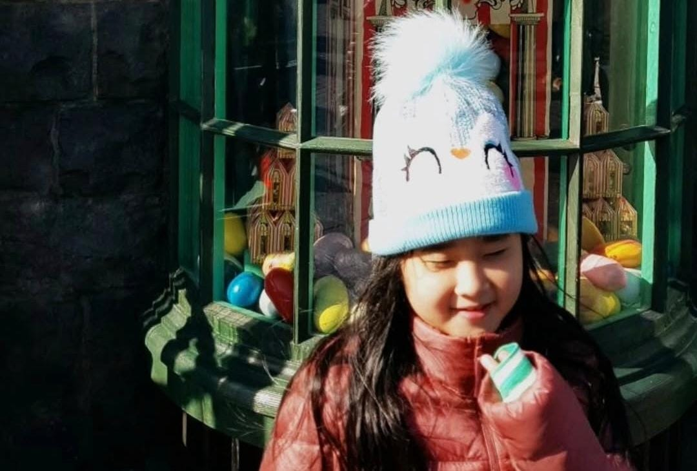
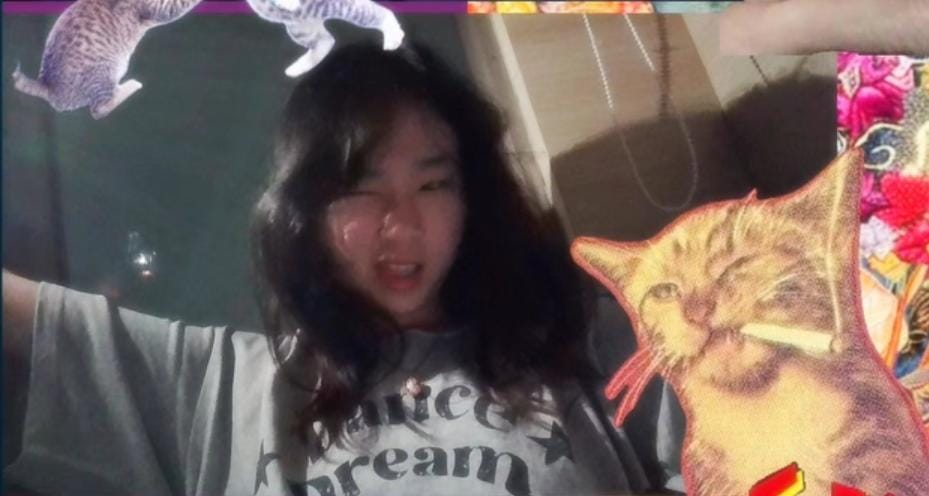
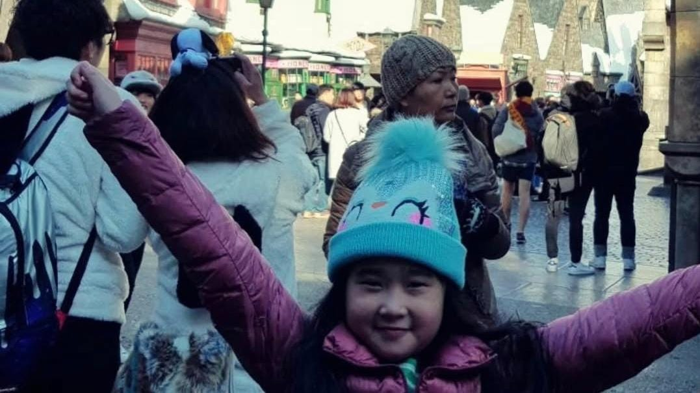

<html lang="en">
  <head>
    <meta charset="utf-8">
    <meta name="viewport" content="width=device-width, initial-scale=1">
    <title>17</title>
    
    <!-- CSS Bootstrap -->
    <link href="https://cdn.jsdelivr.net/npm/bootstrap@5.3.3/dist/css/bootstrap.min.css" rel="stylesheet">
    
    
  </head>
  <body>

    <!-- Notification Alert di Paling Atas -->
    

      

        <strong>🔔 Notifikasi:</strong> Mau lanjut baca? Klik <b>Yes</b> untuk gulir otomatis ke bawah dan tekan tombol <b>"Lihat Detail"</b>!
      

      

        <button type="button" class="btn btn-sm btn-success fw-bold" onclick="scrollDownAndHighlight()">Yes</button>
        <button type="button" class="btn btn-sm btn-outline-danger fw-bold" data-bs-dismiss="alert" aria-label="Close">No</button>
      

    

    <!-- Canvas untuk Animasi Confetti -->
    <canvas id="confetti-canvas"></canvas>

    <!-- Header -->
    <h1 class="p-3 text-center fw-bold shadow-sm" style="background-color: #ffb6c1; color: #fff; text-shadow: 1px 1px 2px rgba(0,0,0,0.2);">
      Hi there, Celine!
    </h1>
    
    

      
      <!-- Carousel Start -->
      

        

          

            
          

          

            
          

          

            
          

        

        <button class="carousel-control-prev" type="button" data-bs-target="#carouselExample" data-bs-slide="prev">
          
          Previous
        </button>

        <button class="carousel-control-next" type="button" data-bs-target="#carouselExample" data-bs-slide="next">
          
          Next
        </button>
      

      <!-- Carousel End -->

      <!-- Section Card -->
      

        
        <!-- Card Standard -->
        

          

            
            

              

                <h5 class="card-title fw-bold">Rahasia</h5>
                
Click buttonnya celllllll

              

              <a href="page1.htm" id="targetBtn" class="btn btn-primary mt-3">Lihat Detail</a>
            

          

        

        <!-- Card Placeholder -->
        

          

            

            

              

                <h5 class="card-title placeholder-glow mb-3">
                  
                </h5>
                

                  
                  
                  
                  
                  
                

              

              
            

          

        

      

    

    <!-- JS Bootstrap -->
    
    
    <!-- Library Animasi Confetti -->
    

    <!-- Script Utama -->
    
  
